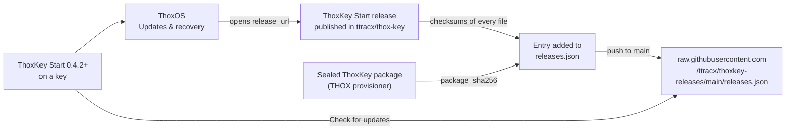

# Development

This repository is data. There is nothing to build and no code to run; "development" here means adding a release entry correctly.

## How the list is used

The address in the middle is sealed into each ThoxKey package. Moving or renaming `releases.json` would stop every key from checking, so the file stays where it is.

## Adding a release

1. The release is published first, with its files and `SHA256SUMS.txt`. The list never names a release that is not public on its release page.
2. Download every file on the release page and check them with `sha256sum -c SHA256SUMS.txt`.
3. Add one entry at the end of `releases`: `host`, `version`, `tag`, `published` (the release's GitHub publication date in UTC), `release_url`, `package_sha256` (from the sealed package the provisioner produced), and one `assets` item per file with its SHA-256. Rules: [FORMAT.md](FORMAT.md).
4. Check the whole file against ThoxKey Start's own parser and the list rules before committing. THOX.ai runs this check with its release tooling; there is no hosted CI.
5. Commit to `main` with a message naming the release, for example `list: start-windows-v0.4.2`, and push.
6. Read the list back from the raw address and confirm the new entry appears.

Never edit a published entry's checksums. If a release is withdrawn, remove its entry in a commit that says why.

## Conventions

- Branch: `main` only; no pull requests.
- Commit prefixes: `list:` for `releases.json`, `docs:` for documentation.
- JSON: two-space indent, fields in the order shown in FORMAT.md, lowercase hex.
- Writing: plain declarative sentences, no em dashes, no emojis.

## Known limits

- The release pages and files are in a private repository; only accounts with access can download them.
- The list is not signed. Its integrity rests on GitHub HTTPS and on write access to this repository.
- Windows is the only computer type listed so far.
- ThoxKey Start 0.4.1 and older cannot read the list; their first update is manual.

## Roadmap

- Add `start-windows-v0.4.2` once its sealed package names this list (published 2026-11-10; package being resealed).
- Add Linux and macOS entries when those releases are published.
